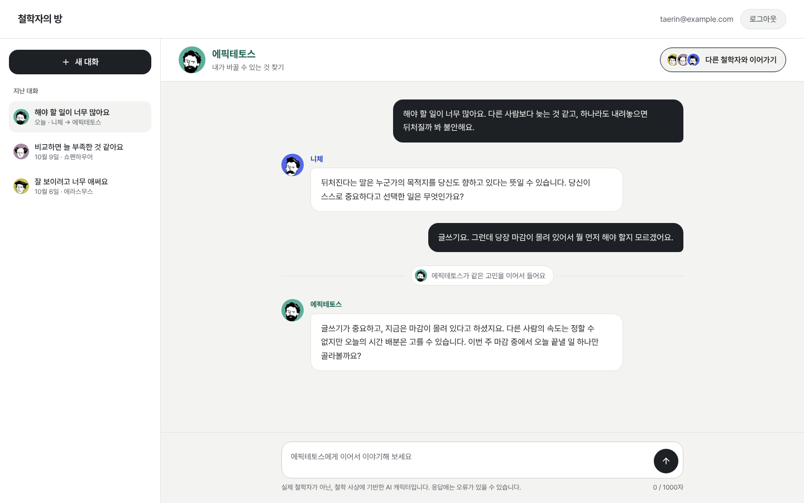
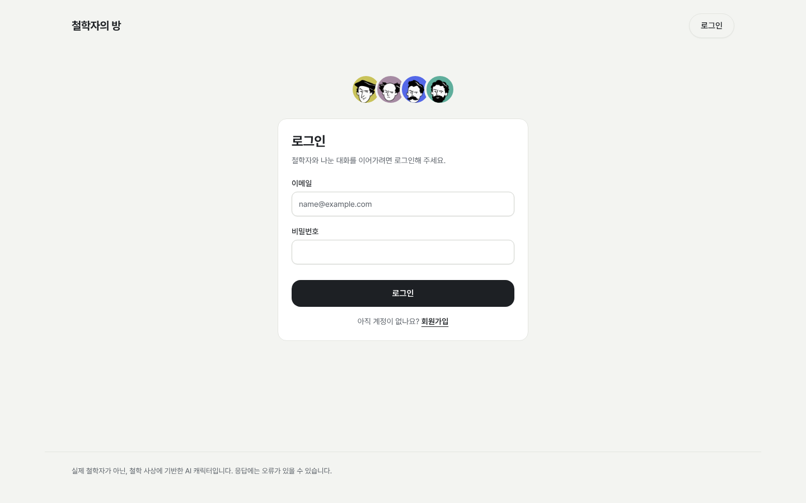
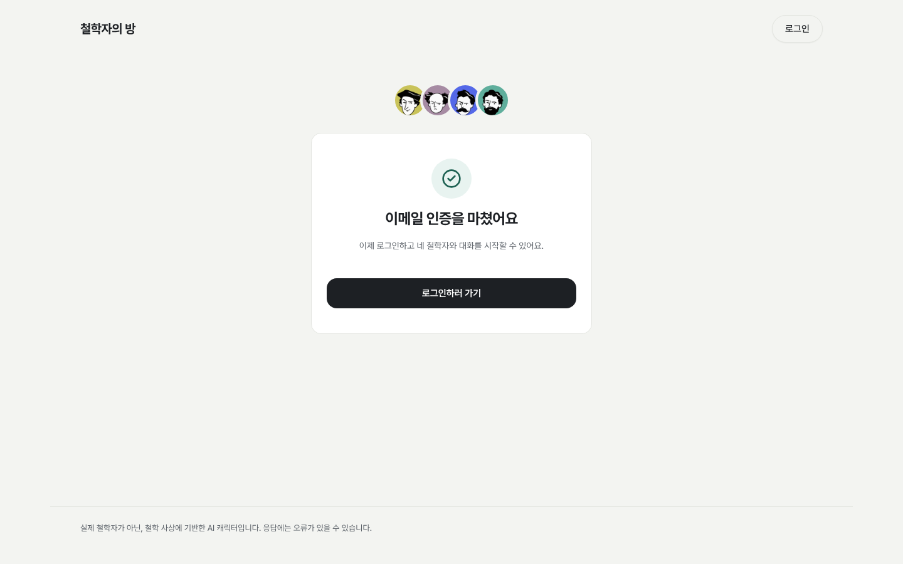

# 🏛️ 《철학자의 방》 (Philo)

> **"하나의 일상 고민을 네 철학자의 시선으로 살펴보는 AI 대화 서비스"**  
> 진로와 관계, 선택의 기로에서 고민하는 이들을 위해 철학 사상 기반의 AI 페르소나와 실시간으로 대화하며 생각의 지평을 넓히는 웹 서비스입니다.

[-orange?style=flat-square&logo=amazon-aws)](http://52.79.249.107)
[](https://fastapi.tiangolo.com/)
[](https://react.dev/)
[](https://mariadb.org/)

---

## 📌 목차
1. [프로젝트 개요](#-1-프로젝트-개요)
2. [핵심 기능 및 화면 구성](#-2-핵심-기능-및-화면-구성)
3. [시스템 구조 및 아키텍처](#-3-시스템-구조-및-아키텍처)
4. [팀 구성원 및 작업 요약](#-4-팀-구성원-및-작업-요약)
5. [배포 및 로컬 실행 방법](#-5-배포-및-로컬-실행-방법)

---

## 💡 1. 프로젝트 개요

### 1) 문제 정의 (Problem)
* 진로, 인간관계, 비교와 인정 욕구 등 일상의 고민에는 하나의 정답이 존재하지 않습니다.
* 그러나 많은 사람들은 익숙한 단일 기준에 얽매여 불안해하거나 결정을 내리지 못합니다.
* 철학은 훌륭한 사고의 도구이지만, 방대한 서적과 난해한 용어로 인해 일상에서 쉽게 접하기 어렵습니다.

### 2) 타겟 사용자 (Target Audience)
* 진로·관계·선택 등 반복되는 일상의 고민을 새로운 시각에서 풀어보고 싶은 현대인
* 타인의 기준과 비교 속에서 번아웃을 겪고 본인만의 기준을 찾고 싶은 사람
* 어려운 철학 책 대신 친근한 대화를 통해 철학 사상을 가볍게 접하고 싶은 사용자

### 3) 핵심 시나리오 (Key Scenario)
> **"같은 대화방에서 끊김 없이 철학자를 전환하여 다각도로 고민을 해결합니다."**

1. 사용자는 네 철학자 중 한 명을 골라 고민(예: *"해야 할 일이 너무 많아 불안해요"*)을 털어놓습니다.
2. **니체**와 대화하며 타인의 기준이 아닌 자신이 진정으로 원하는 가치인지 성찰합니다.
3. 고민을 처음부터 다시 설명할 필요 없이, **같은 대화방에서 '에픽테토스'로 전환**합니다.
4. **에픽테토스**는 이전 대화의 맥락을 모두 파악한 상태에서, *"내가 통제할 수 있는 것과 오늘 당장 실행할 수 있는 행동"*에 집중하도록 실천적 조언을 건냅니다.

| 철학자 | 대화의 관점 및 페르소나 |
| :---: | :--- |
| **에라스무스** | 풍자와 재치로 당연하게 여겨온 사회적 관습과 고정관념을 유쾌하게 돌아봅니다. |
| **쇼펜하우어** | 인간의 채워지지 않는 욕망과 비현실적인 기대가 만드는 삶의 무게를 성찰합니다. |
| **니체** | 남의 기준에 휘둘리지 않고, 스스로 극복하고 개척하는 주체적인 가치를 찾도록 돕습니다. |
| **에픽테토스** | 내가 바꿀 수 없는 외적인 일에 연연하지 않고, 오늘 내가 통제할 수 있는 행동에 집중합니다. |

---

## 🖥️ 2. 핵심 기능 및 화면 구성

| 메인 & 철학자 소개 | 채팅 및 철학자 전환 |
| :---: | :---: |
|  |  |
| **로그인 & 회원가입** | **이메일 인증 링크 안내** |
|  |  |

* **철학자 소개 및 모달 다이얼로그:** 비로그인 상태에서도 네 철학자의 소개와 대표 질문을 둘러볼 수 있습니다.
* **이메일 인증 기반 회원 관리:** SMTP(Gmail 등)를 통한 일회용 보안 토큰 링크 발송 및 인증 성공 시 정식 계정 활성화.
* **동맥락 철학자 전환(Persona Switching):** 대화방 내에서 자유롭게 다른 철학자를 소환하여 이전 맥락을 유지한 채 새로운 관점 획득.
* **커서 기반 무한 스크롤 & 채팅방 삭제:** 대화 기록을 커서 방식으로 끊김 없이 불러오며 불필요한 대화방 영구 삭제 가능.

---

## 🏗️ 3. 시스템 구조 및 아키텍처

### 1) 시스템 구조도

```
                      [ Client (Browser) ]
                               │
                         HTTP (Port 80)
                               ▼
                    ┌──────────────────────┐
                    │     Caddy Server     │ (Reverse Proxy)
                    └──────────┬───────────┘
                               │
               ┌───────────────┴───────────────┐
         /api/*│                               │ /*
               ▼                               ▼
    ┌──────────────────────┐        ┌──────────────────────┐
    │   FastAPI Backend    │        │  React (Vite) Static │
    │     (Port 8000)      │        │       Frontend       │
    └──────────┬───────────┘        └──────────────────────┘
               │
      ┌────────┴────────┐
      ▼                 ▼
┌───────────┐     ┌───────────┐
│  MariaDB  │     │ OpenAI /  │ (Claude Haiku 4)
│  (Port    │     │ LLM API   │
│   3306)   │     └───────────┘
└───────────┘
```

> **참고 (HTTPS/도메인):** 현재 배포 환경은 공인 도메인 없이 AWS EC2 퍼블릭 IP(`52.79.249.107`)로 직접 서비스 중이므로 **HTTP(포트 80)**를 사용합니다. 향후 도메인 연결 시 Caddy의 자동 Let's Encrypt SSL 발급을 통해 손쉽게 HTTPS(포트 443)로 전환 가능하도록 설계되어 있습니다.

### 2) 주요 컴포넌트 역할

| 컴포넌트 | 기술 스택 | 주요 역할 |
| :--- | :--- | :--- |
| **Web Server (Proxy)** | **Caddy** | 단일 IP 진입점으로 80번 포트(HTTP)를 수신하여 `/api/*` 요청은 백엔드로, 그 외 모든 경로는 프론트엔드 SPA(`index.html`)로 무중단 라우팅 |
| **Frontend** | **React 19, TypeScript, Vite, Tailwind CSS, shadcn/ui** | 사용자 인터페이스 렌더링, 컴파운드 컴포넌트 기반 채팅 UI, 반응형 모바일 레이아웃 지원, 토큰 만료 시 Silent Refresh(백그라운드 자동 재발급) 처리 |
| **Backend** | **Python 3.12, FastAPI, SQLAlchemy 2.0, Alembic** | RESTful API 제공, JWT 인증(HttpOnly + SameSite=Lax 쿠키), 리프레시 토큰 로테이션(RTR), LLM 페르소나 프롬프트 주입 및 대화 생성 |
| **Database** | **MariaDB 11** | 유저 정보, 리프레시 토큰, 철학자 시드 데이터, 대화방 및 메시지 이력 영구 보존. 소프트 삭제(`deleted_at`) 및 비관적 행 잠금(`FOR UPDATE NOWAIT`) 적용 |
| **LLM Gateway** | **OpenAI 호환 API (Claude-Haiku-4)** | 철학자별 시스템 프롬프트 주입 및 이전 대화 기록 컨텍스트를 압축/조합하여 실시간 캐릭터 페르소나 답변 생성 |

---

## 👥 4. 팀 구성원 및 작업 요약

총 **4명**의 팀원이 유기적으로 협업하여 기획부터 인프라 배포까지 완결성 있게 구축했습니다.

### 박채연 (pcochoco) — Backend Lead & Security
* **인증 & 보안 파이프라인:** SMTP 기반 일회용 이메일 인증 발송/검증 로직 및 동시성 예외 처리
* **토큰 수명 관리:** Refresh Token Rotation(RTR) 구현 및 안전한 무효화(Revoke) 처리
* **엔터프라이즈 로깅:** 민감정보 마스킹 Formatter, 처리되지 않은 예외 핸들러, Docker 로그 롤링(10MB 회전) 정책 수립

### 김한규 (hkk) — Fullstack & Infra
* **인프라 & 배포:** AWS EC2 기반 Docker Compose 멀티 컨테이너 환경 구축, Caddy 리버스 프록시 연동, MariaDB 초기 시드 데이터 구축
* **프론트엔드 핵심 UI:** 커서 기반 대화 목록 무한 스크롤 및 대화방 삭제 구현, 모바일 반응형 레이아웃 및 렌더링 최적화
* **백엔드 고도화:** 철학자 연속 전환 시 LLM 말투 전염 방지 로직 개발, HTTPS 쿠키 정책 대응, 백엔드 버그 수정

### 임종현 (Jonghyun Lim) — Frontend Lead & Infra
* **채팅 아키텍처:** 실시간 대화 화면 인터랙션 및 상태 관리 로직 컴포넌트 모듈화 분리
* **철학자 전환 UI:** 대화방 내 철학자 변경 구분선 및 변경 모달 다이얼로그 UI 구현
* **라우팅 & 배포 환경:** React Router v7 기반 Auth/Root Layout 분리 및 Mock API 환경 구축, Docker Compose 웹/DB 로깅 및 프론트엔드 정적 서빙 배포 파이프라인 구성 지원

### 김태린 (taelinnkim) — Product Designer & Frontend
* **서비스 기획 & UI 디자인:** 《철학자의 방》 서비스 기획안(`service-plan.md`) 작성, 6개 주요 화면 및 모달 UI 디자인 시안 제작
* **철학자 에셋 & 페르소나:** 4명의 철학자별 초상화·아이콘 에셋 구성 및 프롬프트 페르소나 정립
* **홈 화면 구현:** 홈 랜딩 페이지(HomePage) 및 철학자 상세 정보 다이얼로그 구현, 타이포그래피(Pretendard) 세팅

---

## 🚀 5. 배포 및 로컬 실행 방법

### 1) 사전 준비 사항
* **통합 실행 시:** [Docker](https://docs.docker.com/get-docker/) 및 Docker Compose가 설치되어 있어야 합니다.
* **로컬 직접 실행 시:**
  * Node.js 20+ 및 [pnpm](https://pnpm.io/) (`corepack enable pnpm`)
  * Python 3.12+ 및 [uv](https://docs.astral.sh/uv/)

### 2) 환경 변수 설정 (`.env`)
프로젝트 루트 경로에 `.env.example` 파일을 복사하여 `.env` 파일을 생성하고 필요한 값을 입력합니다.

```bash
cp .env.example .env
```

주요 환경변수 안내:
```ini
# 서버 환경 (local, test, production)
APP_ENV=local
HTTPS_ENABLED=false
BACKEND_PORT=8000

# JWT 비밀키 및 만료일
JWT_SECRET_KEY=your-super-secret-key-at-least-32-chars
JWT_ACCESS_TOKEN_EXPIRE_DAYS=7
JWT_REFRESH_TOKEN_EXPIRE_DAYS=14

# 데이터베이스 설정
DB_HOST=localhost
DB_HOST_DOCKER=mariadb
DB_NAME=philo
DB_USER=philo
DB_PASSWORD=philo_password
MARIADB_ROOT_PASSWORD=root_password

# 이메일 인증 (Gmail SMTP 예시)
FRONTEND_URL=http://localhost
SMTP_HOST=smtp.gmail.com
SMTP_PORT=587
SMTP_USERNAME=your-email@gmail.com
SMTP_PASSWORD=your-app-password
SMTP_FROM_EMAIL=Philo <your-email@gmail.com>

# LLM API 설정 (OpenAI 호환 게이트웨이 또는 공식 OpenAI)
LLM_API_KEY=your-llm-api-key
LLM_BASE_URL=https://api.openai.com/v1
LLM_MODEL=gpt-4o-mini
```

---

### 3) Docker Compose로 통합 실행 (권장)

프로젝트 루트에서 다음 명령어를 실행하면 **Caddy(Web) + FastAPI(Backend) + MariaDB**가 한 번에 빌드 및 기동됩니다.

```bash
# [로컬 개발 환경] docker-compose.override.yml이 자동 병합되어 핫 리로드 및 8000/3306 포트가 함께 열립니다.
docker compose up -d --build

# [운영/배포 서버] override 파일을 무시하고 순수 배포용 설정만 실행할 때:
docker compose -f docker-compose.yml up -d --build

# 실행 로그 실시간 확인
docker compose logs -f

# 컨테이너 종료
docker compose down
```

기동 후 접속 주소:
* **웹 서비스 메인:** `http://localhost` (80번 포트)
* **백엔드 Swagger API 문서:** `http://localhost:8000/docs` (로컬 오버라이드 환경)

---

### 4) 프론트엔드 단독 로컬 개발 실행 (Vite Dev Server)

프론트엔드 화면만 빠르게 개발 및 수정하고 싶을 때 Vite 개발 서버를 로컬에서 직접 띄울 수 있습니다.

```bash
# 1. 프론트엔드 디렉터리로 이동
cd frontend

# 2. 패키지 의존성 설치
pnpm install

# 3. 로컬 개발 서버 실행 (Vite Proxy: /api 요청은 백엔드 localhost:8000으로 자동 포워딩)
pnpm dev

# (옵션) 백엔드 서버 없이 UI만 Mock 데이터로 독립 테스트하고 싶을 때:
VITE_MOCK=true pnpm dev
```

* **Vite 로컬 접속 주소:** `http://localhost:5173`
* 코드 수정 시 HMR(Hot Module Replacement)이 적용되어 브라우저 새로고침 없이 즉시 반영됩니다.

---

### 5) 데이터베이스 마이그레이션 (필요 시)
`docker compose` 기동 시 자동으로 최신 스키마가 적용되지만, 수동으로 마이그레이션을 실행할 경우:

```bash
cd backend
uv run alembic upgrade head
```
