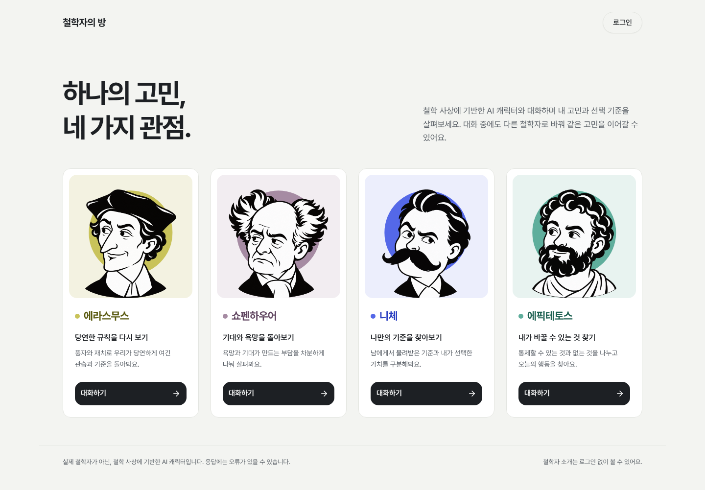
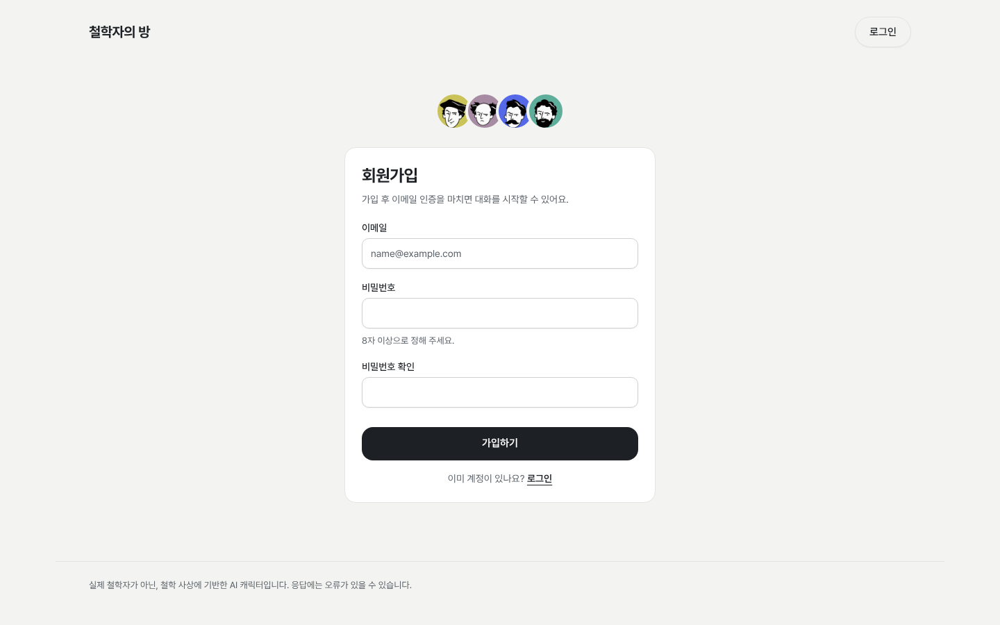
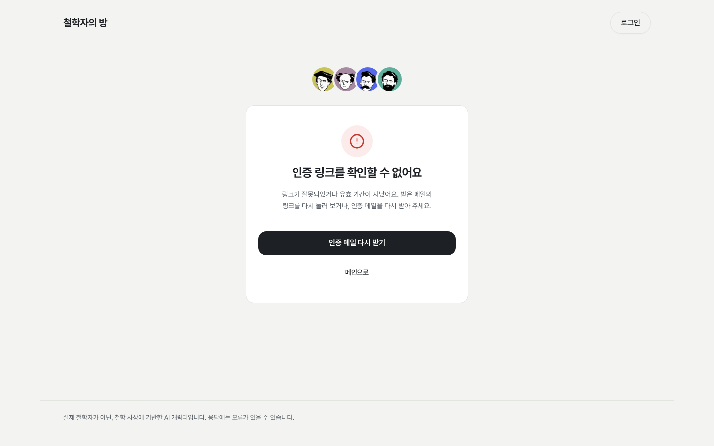
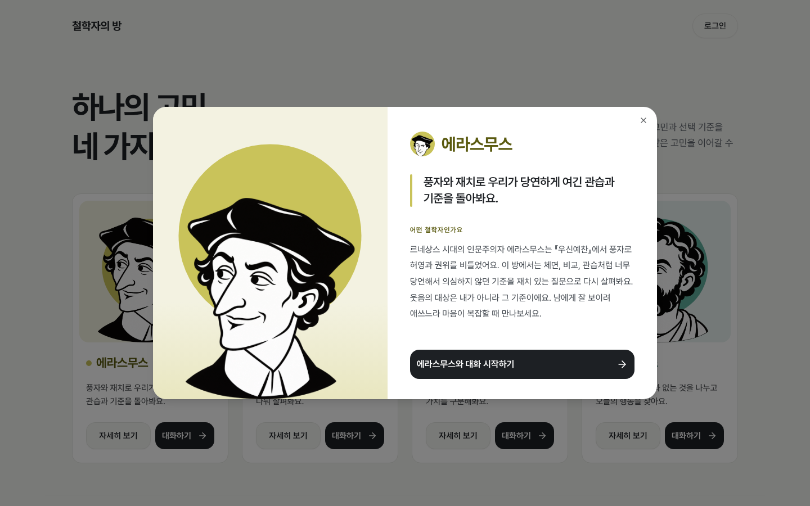
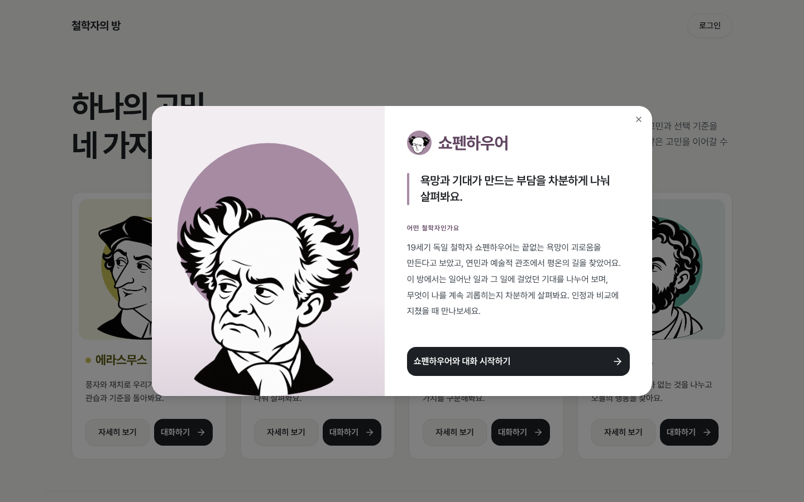
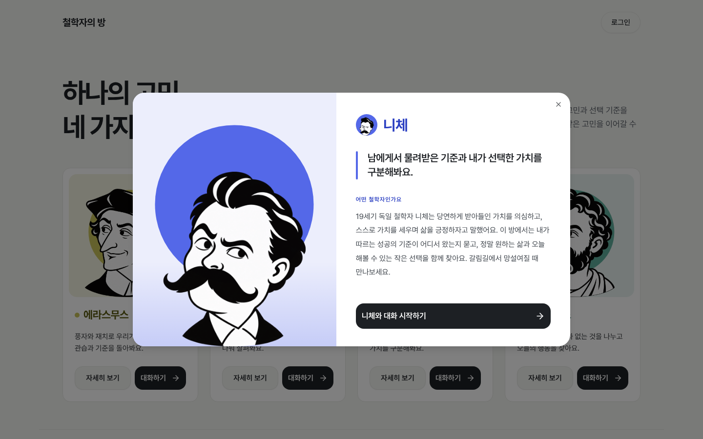
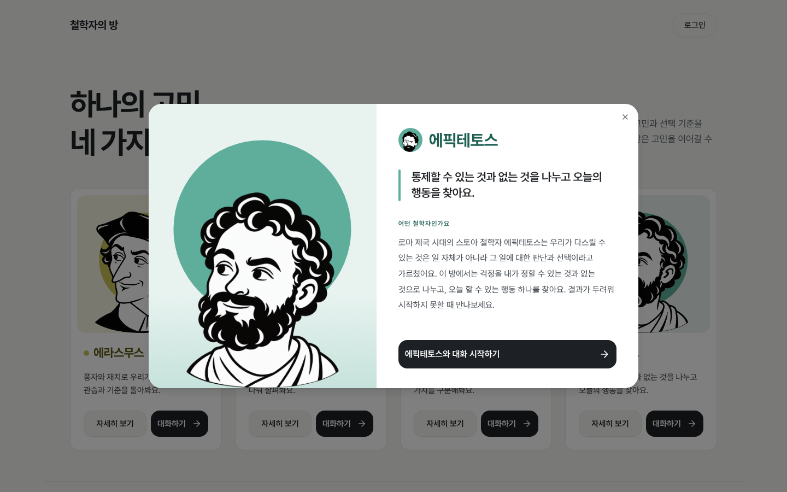
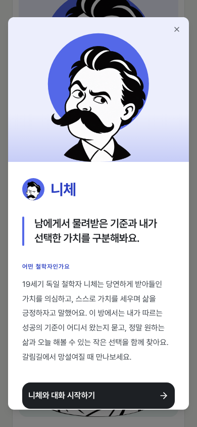

# 《철학자의 방》 서비스 기획안

## 1. 기획 배경과 목적

진로와 관계, 타인과의 비교 등 일상의 고민에는 하나의 정답을 찾기 어려운 경우가 많다. 익숙한 기준에서 벗어나 같은 상황을 다른 관점으로 바라보는 경험이 필요하다는 생각에서 이 서비스를 기획했다.

《철학자의 방》은 **하나의 고민을 네 철학자의 관점으로 살펴보는 AI 대화 서비스**다. 사용자가 철학 지식 없이도 쉬운 대화를 통해 자신의 생각과 선택 기준을 돌아보도록 돕는다. 사용자를 대신해 결정을 내리기보다 새로운 질문과 해석을 제시하는 것을 목표로 한다.

## 2. 대상 사용자와 서비스 특징

- 진로·관계·선택 등 일상의 고민을 다른 시각에서 살펴보고 싶은 사람
- 비교와 인정 욕구 속에서 자신의 기준을 찾고 싶은 사람
- 철학을 어려운 설명보다 대화로 접하고 싶은 사람

사용자는 철학자 한 명을 선택해 대화를 시작하고, 다른 관점이 필요하면 **같은 대화방에서 철학자를 바꾼다.** 기존 대화와 맥락을 유지해 고민을 처음부터 반복 설명하는 부담을 줄인다. 메시지마다 철학자 이름을 표시해 서로 다른 관점을 구분할 수 있도록 한다.

| 철학자 | 대화의 관점 |
| --- | --- |
| 에라스무스 | 풍자와 재치로 당연하게 여긴 관습과 기준을 돌아본다. |
| 쇼펜하우어 | 욕망과 기대가 만드는 부담을 살펴본다. |
| 니체 | 남의 기준과 자신이 선택한 가치를 구분한다. |
| 에픽테토스 | 자신이 선택할 수 있는 것과 오늘 할 수 있는 행동을 찾는다. |

네 캐릭터는 말투뿐 아니라 질문과 해석의 관점에서 차이를 갖는다. 실제 철학자가 아닌 철학 사상에 기반한 AI 캐릭터임을 안내한다.

## 3. 핵심 기능과 이용 흐름

**핵심 기능**

- 회원가입·이메일 인증·로그인
- 철학자 소개 열람과 선택
- AI와 텍스트 대화 및 같은 대화방에서 철학자 전환
- 본인의 대화 기록 저장·조회·삭제

**이용 흐름**

메인에서 철학자 소개 확인 → 로그인 → 철학자 선택 → 채팅 화면 진입 → 첫 메시지로 대화 시작 → 필요하면 철학자 전환 → 지난 대화 다시 열기.

철학자 소개는 로그인 없이 볼 수 있다. 비로그인 상태에서 대화 시작을 누르면 로그인 화면으로 이동하며, 로그인 성공 후 메인으로 돌아간다. 신규 사용자는 회원가입 후 이메일 인증을 완료해야 로그인할 수 있다.

예를 들어 ‘해야 할 일이 많아 불안하다’는 고민을 니체와 이야기하며 자신의 기준을 살펴본 뒤, 에픽테토스로 전환해 오늘 선택할 수 있는 행동을 찾는다.

## 4. 화면 구성

| 화면 | 주요 내용 |
| --- | --- |
| 메인·철학자 소개 | 네 철학자의 초상·소개·대화 시작 버튼. 비로그인 상태에는 로그인 버튼 표시 |
| 로그인 | 로그인 입력과 회원가입 버튼. 로그인 성공 후 메인으로 이동 |
| 회원가입 | 가입 완료 후 로그인 화면으로 이동하며 이메일 인증 안내 |
| 이메일 인증 결과 | 성공·실패 안내. 성공 시 로그인 버튼, 실패 시 잘못된 링크 안내 |
| 채팅 | 현재 철학자, 대화 내역, 메시지 입력·전송, 철학자 전환 |

### 메인·철학자 소개

### 로그인

### 회원가입

### 이메일 인증 성공

### 이메일 인증 실패

### 채팅

### 모달 화면 — 에라스무스

### 모달 화면 — 쇼펜하우어

### 모달 화면 — 니체

### 모달 화면 — 에픽테토스

### 모달 화면 — 모바일

※ 디자인 시안이며, 실제 API 연결 전 화면입니다.
